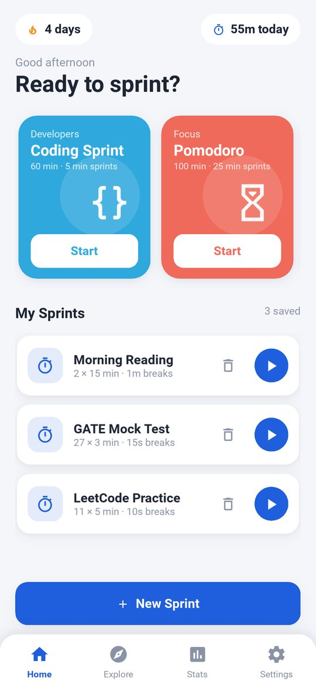
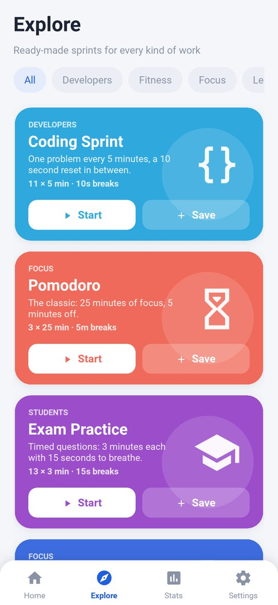
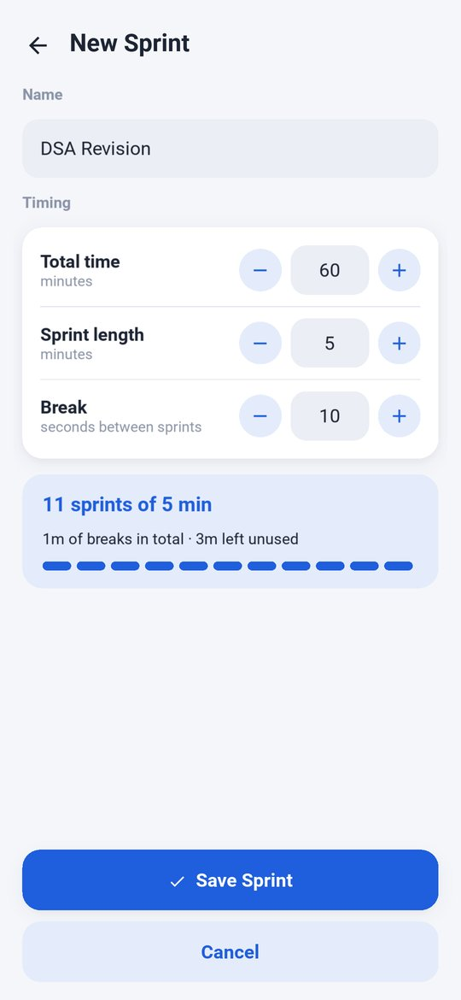
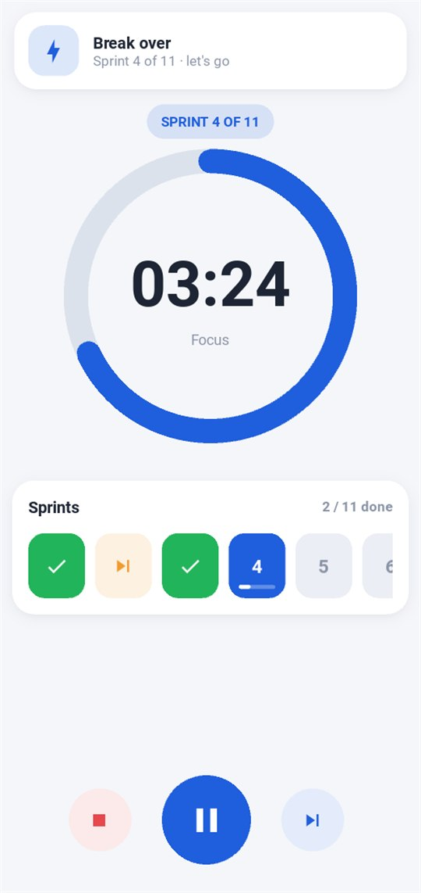
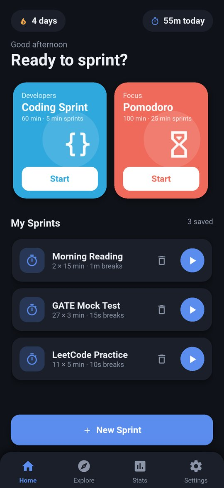
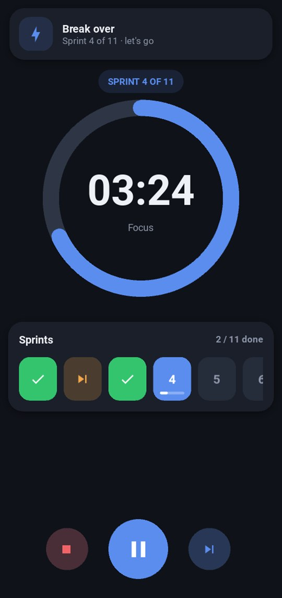
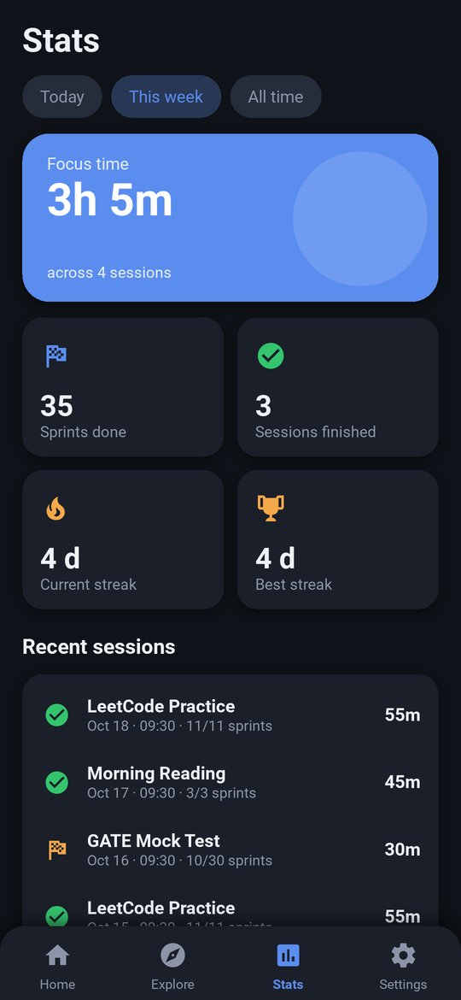
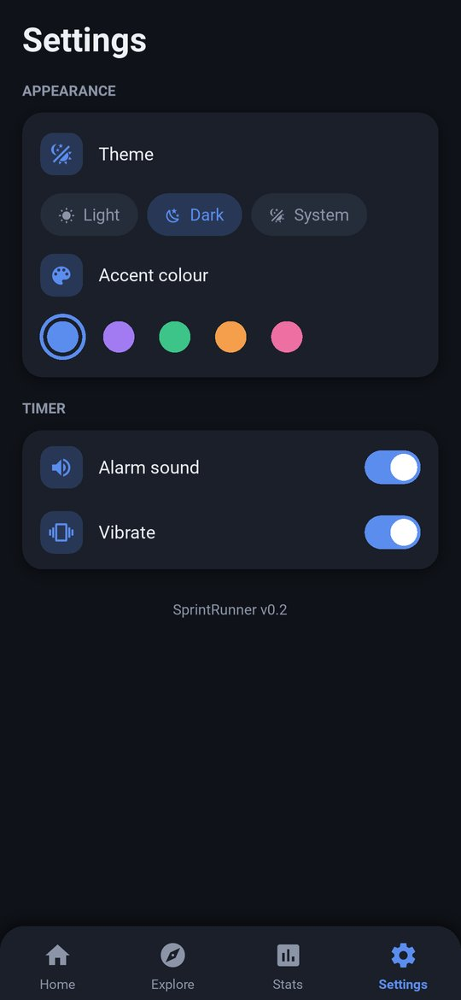

# 🏃 SprintRunner

Sprint Runner is a Python-based productivity timer app that helps you structure focused work sessions using customizable time blocks and breaks.

---

## 📱 App Status: Live & Functional
The core engine and UI have been successfully compiled into a standalone Android APK. 
* **Backend:** Object-Oriented Python (`Task`, `Schedule`, `Timer` modules)
* **Frontend:** Kivy GUI Framework
* **Build System:** Buildozer / GitHub Actions (CI/CD)

## 📱 Screenshots

<p align="center">
  
  
  
  
</p>

**Dark theme**

<p align="center">
  
  
  
  
</p>

## ✨ Features

- ✅ **Customizable Time Blocks** - Set your own work duration (e.g., 5 min per coding problem)
- ✅ **Smart Break System** - Automatic breaks between work blocks (e.g., 10 sec rest)
- ✅ **Reusable Templates** - Save timer configurations and reuse them daily
- ✅ **Visual Progress** - Progress ring plus a swipeable row of sprint tiles (done, skipped, current, upcoming)
- ✅ **Ready-made Templates** - Coding, Pomodoro, exam practice, workouts, reading and more
- ✅ **Stats & Streaks** - Focus time, sprints done, daily streaks and recent sessions
- ✅ **Light, Dark & System Themes** - Plus five accent colours
- ✅ **Gentle Chimes + Notifications** - Short original chimes for sprint done, break over and session complete, with an in-app banner, an Android notification and vibration (sound and vibration can be turned off)
- ✅ **Accurate Timing** - Uses the real clock, so the countdown is correct again as soon as you return to the app

## 🎯 Use Case Example

**Coding Practice Session:**
- Total time: 60 minutes
- Work block: 5 minutes per problem
- Break: 10 seconds between problems
- Result: 10 focused coding sprints with automatic breaks

**Other Use Cases:**
- Exam preparation with timed question-solving
- Exercise routines with rest intervals
- Reading sessions with periodic breaks
- Any task requiring structured time management

## 🛠️ Tech Stack

- **Language:** Python 3.10+
- **GUI Framework:** Kivy 2.3.0 (layout in `src/ui/sprintrunner.kv`)
- **Icons:** Material Design Icons font
- **Data Storage:** JSON (for timer configurations)
- **Audio:** Kivy SoundLoader, chimes generated by `tools/make_sounds.py`
- **Architecture:** Object-Oriented Programming (OOP)

**Dependencies:**
- kivy==2.3.0

### Core OOP Classes:
- `Task` - Timer configuration
- `Schedule` - Generates work/break blocks
- `Timer` - Countdown logic (wall-clock based: pause, resume, skip)
- `TimerRepository` - Save/load functionality
- `SessionLog` - Session history, stats and streaks
- `Settings` - Theme, accent colour, sound and vibration preferences
- `Theme` - Light/dark colour palettes used by every widget
- `Alerts` - Chimes and Android notifications when a sprint, break or session ends
- `HomeScreen`, `ExploreScreen`, `CreateTaskScreen`, `TimerScreen`, `StatsScreen`, `SettingsScreen` - UI screens

## 📲 Installation

### Android APK
Download the latest APK from [Releases](https://github.com/Sasi0026/SprintRunner/releases)

### Build from Source

**Prerequisites:**
- Python 3.10+
- Git
- kivy

**Steps:**
```bash
# Clone repository
git clone https://github.com/Sasi0026/SprintRunner.git
cd SprintRunner

# Install dependencies
pip install -r requirements.txt

# Run locally
python main.py

# Run the tests
pip install pytest
python -m pytest tests
```

### Build Android APK with GitHub Actions

1. Fork this repository
2. Push changes to `main` branch (README/screenshot-only changes don't trigger a build)
3. Go to Actions tab → Build SprintRunner APK (or run it manually with "Run workflow")
4. Download APK from Artifacts

The Android toolchain is pinned in `buildozer.spec` (`p4a.branch`, `kivy` version) and
`build.yml` (`buildozer`, `Cython`). Upgrade them together; an unpinned python-for-android
breaks the build whenever its `master` branch changes.

## 🚀 Roadmap

Sprint Runner is actively developed. Upcoming versions will introduce AI agent features:

### Planned Features

- [ ] **Background Service** - Timer and chimes keep running when the app is minimized or the screen is off
- [x] **Enhanced UI** - Display session stats (blocks completed, remaining time)
- [x] **Statistics Dashboard** - Track productivity over time
- [x] **Block-complete Notifications** - Chime, banner and Android notification when a sprint, break or session ends
- [ ] **Live Notification** - Countdown shown in the notification bar
- [x] **Dark/Light Themes** - Customizable color schemes
- [ ] **Export/Import** - Share timer configs with others
- [ ] **Voice Command Support** - Control sprints and timers hands-free using voice input

### 🤖 AI Agent Features

#### AI Scheduling Agent
- Natural language task input ("Schedule a 2-hour deep work sprint tomorrow morning")
- Intelligent sprint planning based on task priority and deadlines

#### Timer & Break Agent
- Adaptive break suggestions based on your work patterns
- Auto-timer management without manual input

#### Work Organisation Agent
- Smart task grouping and categorisation
- Daily/weekly summary reports

> AI agent features are being built using Python-based LLM orchestration (exploring CrewAI, LangChain).

## 📸 Current Features

**Home:**
- Streak and today's focus time at the top
- Swipeable template cards - tap Start to run one straight away
- Your saved sprints - tap to start, trash icon to delete (with confirmation)

**Explore:**
- All templates with descriptions, filterable by category (Students, Developers, Fitness...)
- Start a template or save it to your sprints

**New Sprint:**
- Name, total time, sprint length and break, with +/- steppers
- Live preview of how many sprints fit, with clear error messages

**Timer:**
- Progress ring and big countdown with the current phase (Sprint 4 of 11 / Break)
- Sprints card: numbered tiles that scroll to the current sprint
  (green ✓ = done, orange = skipped, accent with progress bar = current, grey = upcoming)
- When a block ends: a short chime, a notification banner ("Sprint 3 of 11 done · Take a 10s break"),
  vibration and an Android notification; a separate chime and dialog when the whole session is complete
- Play/Pause, Skip and Stop (asks before ending; progress is still saved)

**Stats:** focus time, sprints done, sessions finished and streaks for today / this week / all time, plus recent sessions

**Settings:** Light / Dark / System theme, accent colour, chime sound and vibration on/off

## 🤝 Contributing

Contributions are welcome! Please feel free to submit a Pull Request.

## 📝 License

This project is licensed under the MIT License - see the [LICENSE](LICENSE) file for details.

## 👨‍💻 Author

**Sasi0026**
- GitHub: [@Sasi0026](https://github.com/Sasi0026)

## Acknowledgments

- Built as a learning project to master OOP in Python
- Inspired by Pomodoro Technique and focus timer apps

---

**Status:** ✅ Functional MVP | 🚧 Active Development


